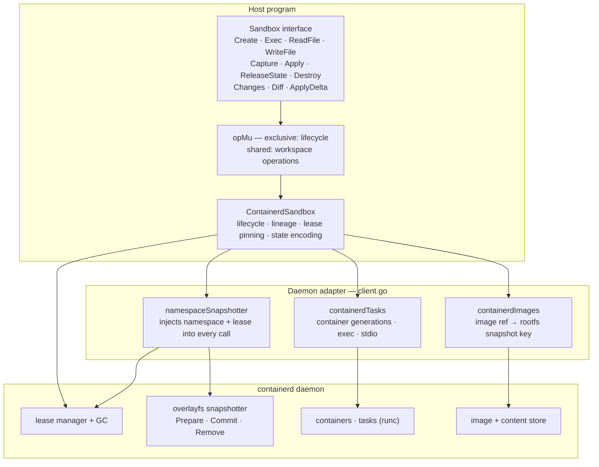
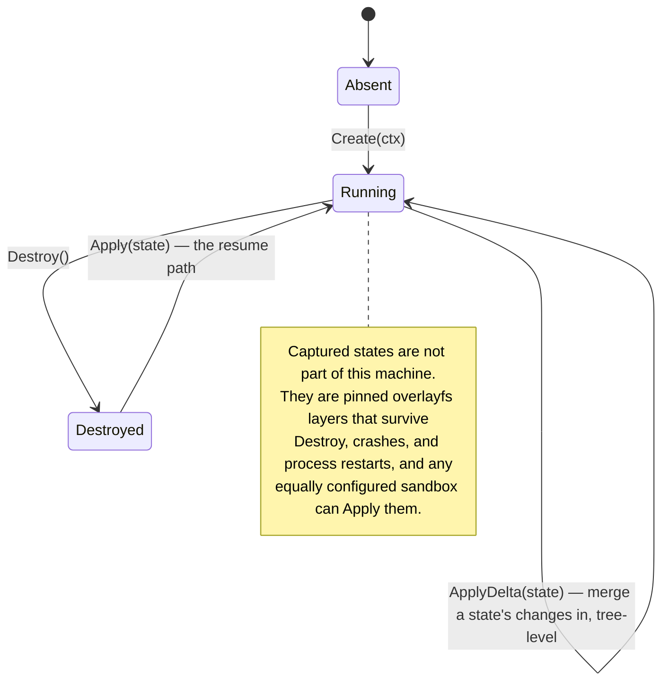
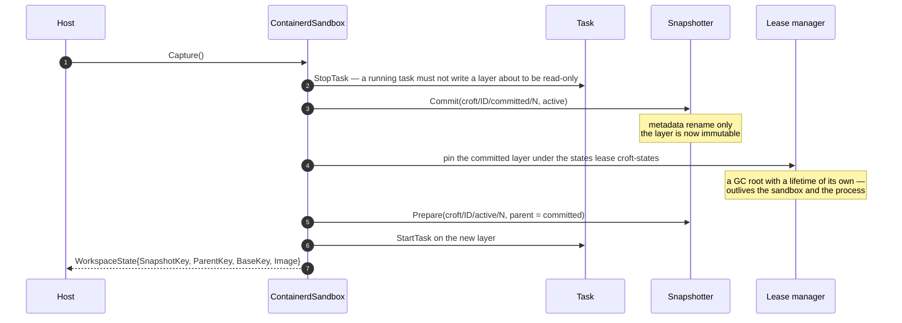
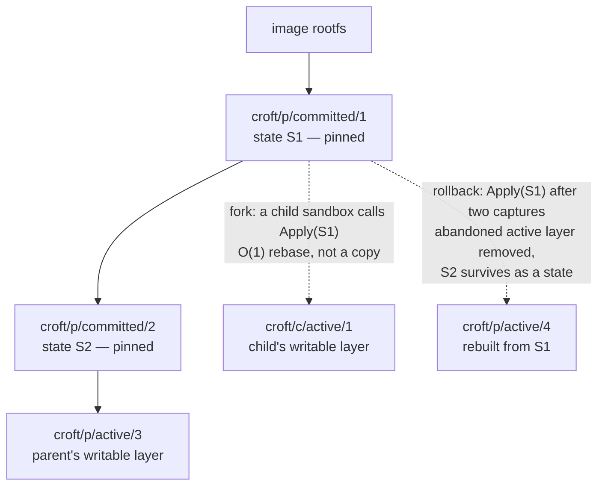

# How croft works, and how to use it

A croft is a small enclosed plot of land one party works on its own. This
document is the map: what the library is made of, how a workspace moves
through its lifecycle, and the shapes of program croft is built for. The
README carries the quick start and the contracts; [verification.md](verification.md)
carries how it is all tested.

## The mental model

Croft gives a program an isolated, snapshot-backed workspace on
[containerd](https://containerd.io)'s overlayfs snapshotter. Three properties
define it:

- **Layered** — every `Capture` commits the writable overlayfs layer into an
  immutable one and continues work on a fresh layer above it. Lineage is
  recorded in the state.
- **States outlive sandboxes** — a captured state is pinned against the
  daemon's garbage collector by a lease with a lifetime of its own. It
  survives `Destroy`, crashes, and process restarts, and any equally
  configured sandbox can resume it.
- **In-band work** — commands and file I/O run inside the boundary, through
  the library. Croft is deliberately not a container runtime; it is the
  library a host uses when it wants a real filesystem boundary per workspace.

## How it fits together



The `Sandbox` interface is the contract; `ContainerdSandbox` implements it
over a real daemon, and `NewWithBackend` lets a host embed the same lifecycle
over collaborator implementations it already holds (tests use an in-memory
fake that enforces the same snapshotter invariants).

## The lifecycle



Concurrency is part of the contract: lifecycle operations (`Create`,
`Destroy`, `Capture`, `Apply`) hold an exclusive op-level lock, workspace
operations (`Exec`, `ReadFile`, `WriteFile`, `ReleaseState`) a shared one.
An in-flight Exec therefore finishes before a Capture commits the layer it is
writing to — by construction. Waiting for the lock does not honor context
cancellation; a hung Exec delays a waiting Destroy until it returns.

### Creating a workspace

`Create` resolves the image rootfs, prepares the base active snapshot, starts
a long-lived task on it, and provisions the in-container workdir. The task
stays up between commands; every `Exec` runs against it. The caller bounds
the whole operation with its own context. The sandbox lease makes the
sandbox's snapshots GC roots for the sandbox's own lifetime — without it the
just-committed layer has no referencing container in the window between a
`Capture`'s stop and restart, and the daemon may reclaim it.

### Capturing: the core move

`Capture` is what makes work resumable. A committed layer must stop being
written to — containerd's commit is a metadata rename, and the freshly
committed layer immediately becomes a lowerdir of the next active layer,
which OverlayFS forbids writing. So the task is stopped, the layer committed,
a successor prepared, and the task restarted.



The returned `WorkspaceState` is a plain four-field record. Capture is
non-mutating: the caller's workspace metadata is left as it was found. The
price of a coherent snapshot is in-container process state: stopping the task
kills it. Files persist; running processes do not.

### Applying: rollback, resume, and fork

`Apply` prepares a fresh active snapshot from a state's committed layer and
rebinds the sandbox's identity to it. It does not replay changes into an
existing tree — it re-points the workspace at the captured layer, which is
O(1) and exact. On success the applied state's layer is recorded as this
sandbox's lineage, including when the state came from another sandbox.



Three consequences worth internalizing:

- **Rollback does not erase history.** Layers created after the applied state
  are no longer ancestors of anything the sandbox runs on, but each was handed
  to a caller as a state, so they stay pinned until released.
- **Sharing a state is a rebase, not a copy.** Copying upper directories would
  resurrect deleted files (whiteouts) and flatten directory opacity. Making a
  committed snapshot another layer's parent is what preserves them.
- **Apply works from nothing.** A fresh `ContainerdSandbox` — same config, new
  process — can `Apply` a state it was handed. That is the crash-resume path.

### Merging: ApplyDelta, the three-way merge

`Apply` rebinds; it does not combine. When two sandboxes diverged from the
same base and one lineage's work must land in the other's tree, `ApplyDelta`
merges it — tree-level, without git, without a patch payload, and without
stopping the task. The merge base rides the state: every capture records the
layer its sandbox last `Apply`ed as `BaseKey`, so a state knows what its own
changes are relative to.

```mermaid
sequenceDiagram
    autonumber
    participant H as Host
    participant A as Sandbox A — ours
    participant D as Daemon diff service
    participant K as Snapshotter

    Note over A: A's tree diverged from base B;<br/>state T's lineage diverged from B too
    H->>A: ApplyDelta(T)
    A->>K: View(B), View(T) — committed layers mount through views
    A->>D: Compare(B → T) — "theirs" blob
    A->>K: View(B)
    A->>D: Compare(B → A's active) — "ours" blob
    Note over A: parse both blobs, merge per path:<br/>theirs-only applies · ours-only keeps<br/>identical edits keep · anything else conflicts
    alt any conflict
        A-->>H: ErrDeltaConflict(paths) — zero mutations ran
    else clean
        A->>A: apply through the task: rm · mkdir · WriteFile · ln -s
        A-->>H: nil — merged
    end
```

Everything is computed before anything is written: both diffs, both parses,
the merge, and the applicability plan. A conflict therefore refuses exactly —
`ErrDeltaConflict` names the paths and the workspace is bit-identical to
before the call. The application phase after a clean merge is *not*
transactional (parity with the git-era version's `git apply` path).
Granularity is per-file: divergent same-file edits conflict even on disjoint
lines — refuse rather than pretend, with line-level merge a scoped follow-up.
The base must still be pinned: a released base surfaces `ErrStateUnavailable`,
the same contract `Changes`/`Diff` carry.

### Giving disk back

`Destroy` stops the task, removes the active layer, and releases the sandbox
lease — deliberately *not* the committed layers: every one was returned to a
caller as a state, and a sibling sandbox may be running on a child of the
same layer. `ReleaseState` is the deliberate reclaim path; it is idempotent,
and the daemon's GC reclaims the layer once nothing references it.

## Using croft: recipes

### A checkpointed dev loop

```go
sb := croft.New(croft.Config{Namespace: "croft", Image: "docker.io/library/golang:1.26"})
if err := sb.Create(ctx); err != nil { ... }
defer sb.Destroy(ctx)

res, _ := sb.Exec(ctx, croft.ExecRequest{Command: "go", Args: []string{"test", "./..."}})
good, _ := sb.Capture(ctx)   // tests green: pin it, keep working
```

Each `Capture` costs a task restart but leaves the sandbox running on a fresh
layer; capture as often as the work is worth keeping.

### Rollback

```go
_, _ = sb.Exec(ctx, croft.ExecRequest{Command: "make", Args: []string{"mess"}})
_ = sb.Apply(ctx, good)      // the workspace is exactly what it was
```

### Fork: speculative parallel exploration

There is no fork orchestration; capture on the parent, apply on the child is
the whole recipe:

```go
base, _ := parent.Capture(ctx)

child := croft.New(parentConfig)   // same namespace, image, snapshotter
_ = child.Apply(ctx, base)         // Create is not needed on the resume path

// parent and child now explore divergent futures from the same plot;
// whichever branch wins, the loser's states are reclaimed with ReleaseState
```

### Merge: recombining diverged work

The losing branch's work does not have to be discarded — if the child
captured it, the parent can merge it in instead of rebasing onto it:

```go
theirs, _ := child.Capture(ctx)        // BaseKey = the shared base
err := parent.ApplyDelta(ctx, theirs)  // tree-level merge onto the parent's tree
if errors.Is(err, croft.ErrDeltaConflict) {
    // both sides touched the same paths incompatibly; nothing was written
}
```

### Crash-resilient work

States outlive the sandbox that captured them. A host records the
`WorkspaceState` (it is a plain struct; hash it if a record identity is
needed) and, after a crash, hands it back:

```go
// fresh process, same Config:
_ = sb.Apply(ctx, lastCaptured)    // pick up exactly where the capture left off
```

### Cleanup discipline

Disk comes back through `ReleaseState`, `Destroy`'s active-layer removal, or
namespace teardown — in that order of specificity:

```go
_ = sb.ReleaseState(ctx, superseded)
```

## Contracts worth knowing

- **States have no lifecycle.** Nothing expires them and nothing reclaims
  them implicitly; `ReleaseState` is the only discard verb. `Destroy` never
  touches committed layers.
- **Applying a different state moves the sandbox again.** Callers must not
  assume two sandboxes applying the same state share identity.
- **A state's identity is its snapshot key** — sequence-derived, so two
  captures of identical content produce distinct states. Identity, not
  content equality; a content-derived state identity is a recorded follow-up.
- **A state's base is its merge base.** `BaseKey` records the layer the
  capturing sandbox last Applied; `ApplyDelta` diffs against it. A state
  captured without any Apply has no base and cannot be merged. ApplyDelta
  never moves the base — a merge is not a rebase.
- **The image contract.** The workspace's file operations shell out inside
  the container, so the image must provide a shell and the small coreutils
  croft itself uses: `mkdir`, `cat`, `dirname`, `printf`, `base64`, `chmod`;
  the diff machinery adds `ls` and `readlink`, the delta machinery `rm` and
  `ln`.
- **Exec stdin is unsupported** (`ErrStdinUnsupported`): the runc-v2 shim
  holds the exec's stdin FIFO open for the process's lifetime, so a reader
  would never see EOF. Pass data as arguments, as `WriteFile` does — whose
  content travels base64-encoded in argv, visible in `/proc/*/cmdline`; do
  not write secrets with this backend.
- **Capture costs process state.** Stopping the task kills running
  processes; files persist. A coherent snapshot and a live process tree do
  not coexist in this design.
- **Containment is honest, not absolute.** Namespaces plus a separate rootfs:
  strong, but a kernel exploit escapes it.
- **Linux only.** OverlayFS and the containerd daemon require Linux with root
  or user namespaces. Setting `Config.FIFODir` to a user-writable path lets an
  unprivileged caller sharing the daemon socket drive the whole thing.

## Configuration that matters

`croft.Config` carries: `Address` (daemon socket), `Namespace` (isolation from
other containerd users), `Image` (required — the base rootfs), `Runtime`,
`Snapshotter` (default `overlayfs`; others differ in commit semantics),
`InitArgs` (the keep-alive command, default `sleep infinity`), `Workdir`
(default `/workspace`), `WriteChunkBytes` (per-exec write payload),
`FIFODir` (client-side stdio FIFOs — set it to drive the daemon without
root), and `Limits` (CPU shares/quota, memory, pids caps on every container
generation the sandbox starts; nil is unbounded — the multitenancy fairness
floor). See `Config` in `sandbox.go` for the full contract of each field.
